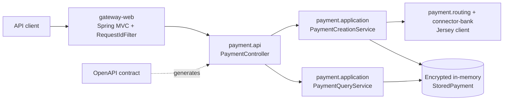
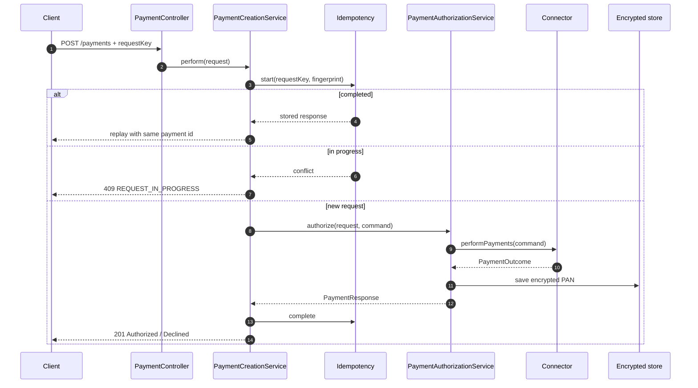

# Payment Gateway — Java Take-Home

A small, contract-first payment gateway built with Java 17 and Spring Boot 3.1.5. The design
focuses on safe retries, explicit card-data boundaries, observable payment outcomes and a clean
separation between the gateway and its bank dependency.

---

## At a Glance

- `POST /payments` returns Authorized or Declined after a bank call.
- Invalid requests return Rejected without creating a payment or calling the bank.
- `GET /payment/{id}` retrieves a stored payment.
- OpenAPI defines the public and bank contracts.
- `requestKey` provides idempotent retries.
- CVV is never persisted; PAN is encrypted at rest.
- POST omits the card number; GET returns a masked number.
- Micrometer metrics and Actuator health endpoints are exposed.
- `make verify` runs the full test suite; `make up` runs the Docker Compose stack.

---

## Key Contributions

| Contribution                        | Why it matters                                                                                                                                                    |
|-------------------------------------|-------------------------------------------------------------------------------------------------------------------------------------------------------------------|
| **OpenAPI-first API**               | Generated controller/models/validation keep the contract and implementation aligned.                                                                              |
| **Feature-based modules**           | Payment code is grouped under `payment.api`, `application`, `domain`, `idempotency`, `persistence`, `routing` and `observability`.                                |
| **Idempotency before side effects** | A `requestKey` is reserved before the bank call; completed, failed and in-progress outcomes are handled explicitly.                                               |
| **Explicit card-data boundary**     | A transient command is mapped to encrypted storage; CVV never enters the persistence model.                                                                       |
| **Minimal card-data exposure**      | POST returns no card number; GET returns only the masked number and last four digits.                                                                             |
| **Connector SPI**                   | The gateway depends on `IPaymentProcessor`, not on the bank implementation.                                                                                       |
| **Unified bank error handling**     | Bank failures are translated into connector-neutral exceptions and mapped centrally to consistent API errors; controller code never handles bank-specific errors. |
| **Observable outcomes**             | Payment, latency and idempotency metrics use bounded tags with no card data.                                                                                      |
| **Test gate**                       | Unit tests plus `PaymentGatewayIT` under Failsafe; `mvn verify` is the real CI entry point.                                                                       |

---

## Architecture



### Module boundaries

| Module | Responsibility |
| --- | --- |
| `gateway-web` | Boot entry point, filters, Swagger and Actuator |
| `gateway-app` | Payment feature: API, application, persistence, routing |
| `connector-api` | Stable connector SPI and shared error model |
| `connector-bank` | Bank simulator adapter |

---

## Payment Flow



Key rules:

- Same key + same payload + completed → replay.
- Same key + same payload + failed → replay terminal failure.
- Same key + different payload → `409`.
- Same key + request still running → `409`.
- The fingerprint is a compact SHA-256 over canonical fields; the full request is not serialized.

---

## API Surface

| Method | Path            | Result                       |
|--------|-----------------|------------------------------|
| `POST` | `/payments`     | `201` Authorized or Declined |
| `GET`  | `/payment/{id}` | `200` payment or `404`       |

Required create fields:

- `requestKey`: UUID idempotency key;
- `bankId`: `bank-simulator`;
- `source`: card details;
- `amount`: positive integer minor units with `GBP`, `USD` or `EUR`.

Card-data exposure:

| Operation | `source.number` |
| --- | --- |
| `POST /payments` | omitted |
| `GET /payment/{id}` | `**** **** **** 1234` |

### Payment outcomes

| Outcome        | Meaning                                                                                                                                    | Bank called | Payment stored |
|----------------|--------------------------------------------------------------------------------------------------------------------------------------------|-------------|----------------|
| **Authorized** | Acquiring bank authorized the payment.                                                                                                     | Yes         | Yes            |
| **Declined**   | Acquiring bank declined the payment.                                                                                                       | Yes         | Yes            |
| **Rejected**   | Invalid information was supplied, so no payment was created and the bank was not called.                                                   | No          | No             |
| **Unknown**    | The gateway cannot determine a definitive payment outcome; the bank may or may not have been called, and the payment may or may not exist. | Unknown     | Unknown        |

`Rejected` is a payment-creation outcome for invalid input. `Unknown` is an operational status for
ambiguous bank outcomes; it is not a successful or declined payment. `GET /payment/{id}` only
returns stored Authorized or Declined payments.

### Error code mapping

All error responses use the shared envelope with `id`, `status`, `code`, `message` and field errors.
The `code`, HTTP status and envelope status identify the actual failure:

| HTTP  | Code                         | Envelope status | When                                               | Bank called | Payment stored |
|-------|------------------------------|-----------------|----------------------------------------------------|-------------|----------------|
| `400` | `PAYMENT_REJECTED`           | `Rejected`      | Validation or expiry/source rejection              | No          | No             |
| `400` | `INVALID_REQUEST`            | `Rejected`      | Malformed JSON, wrong type, invalid path parameter | No          | No             |
| `400` | `UNSUPPORTED_BANK`           | `Rejected`      | Requested bank id is not configured                | No          | No             |
| `404` | `PAYMENT_NOT_FOUND`          | `Rejected`      | Lookup id does not exist                           | No          | No             |
| `405` | `METHOD_NOT_ALLOWED`         | `Rejected`      | Unsupported HTTP method                            | No          | No             |
| `409` | `IDEMPOTENCY_KEY_REUSED`     | `Rejected`      | Same requestKey with a different payload           | No new call | No             |
| `409` | `REQUEST_IN_PROGRESS`        | `Rejected`      | Duplicate requestKey while the original is running | No new call | No             |
| `415` | `UNSUPPORTED_MEDIA_TYPE`     | `Rejected`      | Non-JSON content type                              | No          | No             |
| `500` | `INTERNAL_ERROR`             | `Unknown`       | Unexpected gateway failure                         | Unknown     | Unknown        |
| `502` | `ACQUIRING_BANK_ERROR`       | `Unknown`       | Bank rejected or returned an unreadable response   | Yes         | No             |
| `503` | `ACQUIRING_BANK_UNAVAILABLE` | `Unknown`       | Bank 5xx, timeout or unavailable                   | Yes/unknown | No             |

### Rejected error example

Invalid CVV:

```json
{
  "requestKey": "8f14e45f-ceea-467a-9d0b-1c0a7c3a9e21",
  "bankId": "bank-simulator",
  "source": {
    "type": "CREDIT_CARD",
    "number": "2222405343248877",
    "expiryMonth": 6,
    "expiryYear": 2030,
    "cvv": "12"
  },
  "amount": { "value": 100, "currency": "GBP" }
}
```

The gateway responds with HTTP `400`:

```json
{
  "id": "b4b7a4c2-6e4d-4e0b-9e9e-4f5c3a2b1d00",
  "status": "Rejected",
  "timestamp": "2026-11-14T08:00:00Z",
  "code": "PAYMENT_REJECTED",
  "message": "Payment request validation failed",
  "errors": [
    {
      "field": "source.cvv",
      "message": "must match \"^[0-9]{3,4}$\""
    }
  ]
}
```

No bank call is made and no payment is stored.

The error envelope uses `Rejected` for validation, request and idempotency errors.
`500 INTERNAL_ERROR`, `502 ACQUIRING_BANK_ERROR` and `503 ACQUIRING_BANK_UNAVAILABLE` use `Unknown`:
This is a response-status change, not a complete UNKNOWN lifecycle

---

## Card-Data and Storage Boundary

```text
PaymentCommand (transient PAN + CVV)
        │
        ▼
PaymentPersistenceMapper
        ├── CardDataProtector.encrypt(paymentId, PAN)
        ▼
StoredPayment(payment, encryptedPan)
        │
        ▼
PaymentRepository
```

- CVV is not part of `StoredPayment`, the repository API or the GET read model.
- AES-GCM uses a random IV and a payment-specific key derived from the payment id.
- GET decrypts PAN only inside the persistence boundary and returns masked data.
- The master key is in-memory for this exercise; production would use KMS/HSM.
- The public contract currently models card payments only.

---

## Observability

Implemented with Micrometer and Actuator:

- `payments.created` — status and bank;
- `payment.authorization.duration` — status and bank;
- `payment.idempotency.replays` — outcome;
- `payment.idempotency.conflicts` — reason.

Endpoints:

```text
/actuator/health
/actuator/health/liveness
/actuator/health/readiness
/actuator/metrics
/actuator/prometheus
```

Tags are deliberately bounded. Card numbers, CVV, request keys and customer data are never metric
tags.

---

## Packaging and Hosting

### Packaging

- `spring-boot-maven-plugin` produces an executable fat jar.
- `Dockerfile` uses a Maven build stage and an `eclipse-temurin:17-jre` runtime stage.
- The runtime image starts `/app.jar` with:

```dockerfile
ENTRYPOINT ["java", "-jar", "/app.jar"]
```

- The bank simulator is **not** packaged into the gateway image.

### Local hosting

```bash
make up
```

This builds the gateway image, starts both services and waits for gateway readiness.

| Service        | Compose name     | Host access             |
|----------------|------------------|-------------------------|
| Gateway        | `gateway`        | `http://localhost:8081` |
| Bank simulator | `bank-simulator` | `http://localhost:8080` |

Inside Compose, the gateway reaches the bank at `http://bank-simulator:8080`. Configuration is
injected with `SERVER_PORT` and `BANK_BASE_URL`; the image does not hard-code environment addresses.

```bash
make logs   # follow gateway + bank logs
make down   # stop the stack
```

Health output is available at `/actuator/health`; logs are written to stdout/stderr. Production would
replace Compose with a managed container platform while keeping the same health and logging contract.

---

## Assumptions and Boundaries

### In scope

- Two endpoints: create and lookup.
- OpenAPI-first card API.
- Idempotent retries via `requestKey`.
- Encrypted PAN at rest; CVV never persisted.
- Micrometer/Actuator observability.
- Local Docker Compose hosting.

### Deliberately out of scope

- Authentication, tenant isolation and rate limiting.
- Durable payments or idempotency storage.
- Database transactions, outbox and reconciliation.
- KMS/HSM key management and key rotation.
- 3DS, capture, refund, void, webhooks and settlement.
- Multi-instance deployment.

### Known risks

- Payments and idempotency are in-memory; restart loses them.
- The encryption master key is process-local.
- `PaymentResponse` is still used as the in-memory persistence payload.
- The API must not be exposed publicly without authentication.

---

## Testing

- **120 tests**: 92 unit tests and 28 integration tests.
- `gateway-app`: 57, `connector-api`: 10, `connector-bank`: 20, `gateway-web`: 5.
- `PaymentGatewayIT`: 28.
- Branch-focused tests cover response exposure, idempotency states, validation, encryption failures,
  connector routing, error handling, metrics tags and configuration.

```bash
make verify
# or
./mvnw clean verify
```

`mvn test` runs unit/slice tests; Failsafe runs `PaymentGatewayIT` during `verify`.

---

## Running Locally

```bash
make verify   # full build + unit + integration tests, no Docker
make run      # local jar + bank simulator, gateway on :8090
make up       # gateway + bank via Docker Compose, gateway on :8081
make down     # stop the Compose stack
```

`make run` waits up to 60 seconds for the bank simulator. Override when needed:

```bash
make run WAIT_TIMEOUT=120
```

---

## Future Evolution

1. **Tenant identity:** accept a tenant/merchant id from an authenticated header or token and scope
   idempotency to `(tenantId, requestKey)` so different tenants can reuse the same request key
   without conflicts.
2. Replace in-memory storage with PostgreSQL and a durable idempotency table.
3. Separate API DTOs from domain and persistence models.
4. Add authentication, merchant scopes and rate limiting.
5. Use KMS/HSM for encryption keys and rotation.
6. Add circuit breakers and bank-specific idempotency.
7. Model `PENDING`/`UNKNOWN` outcomes and reconciliation.
8. Add Testcontainers, contract tests and concurrency tests.
9. Add distributed tracing and PII-safe audit logs.

---

## Project Layout

```text
Dockerfile             gateway image (fat jar + JRE 17)
.dockerignore          Docker build exclusions
Makefile               verify/run/up/down workflow
docker-compose.yml     gateway + bank simulator local stack

gateway-web/           Boot application, filters, Swagger/Actuator
gateway-app/           payment feature
  payment/api          controller + response builders
  payment/application  creation, authorization, query services
  payment/domain       validation
  payment/idempotency  state machine + fingerprint
  payment/observability metrics
  payment/persistence  encrypted store + mapper
  payment/routing      connector registry

connector-api/         IPaymentProcessor SPI + errors
connector-bank/        bank simulator adapter + Jersey client
```
