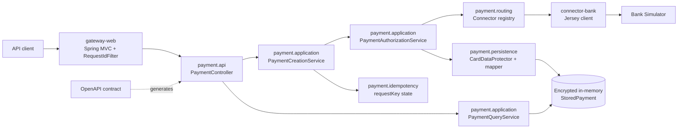
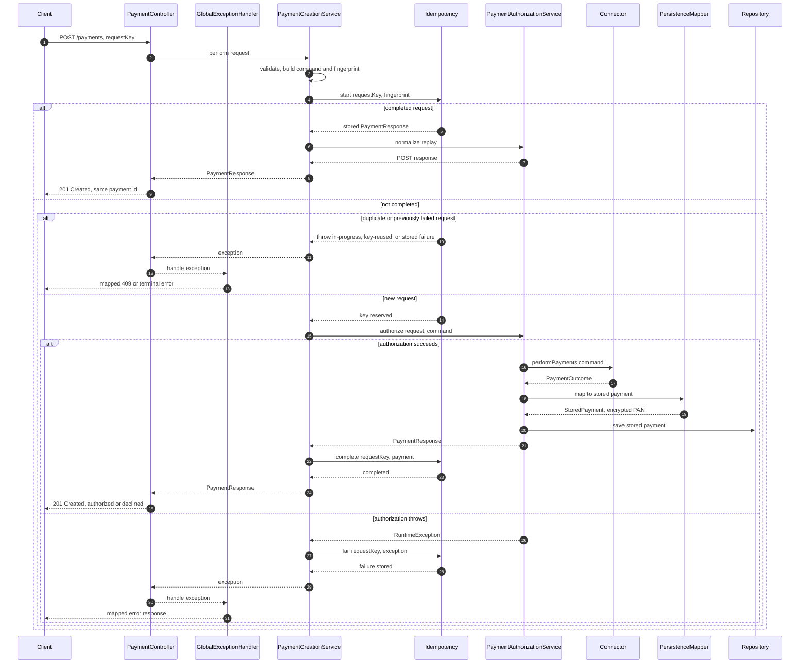
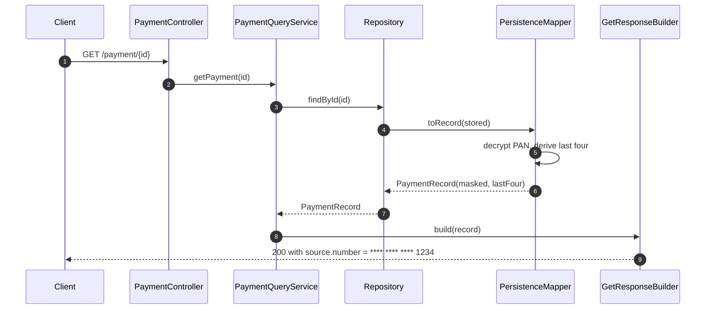
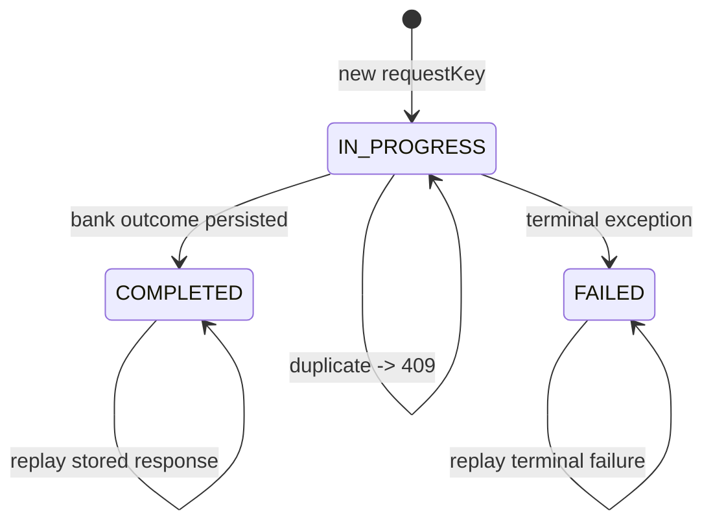
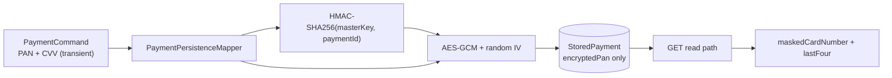
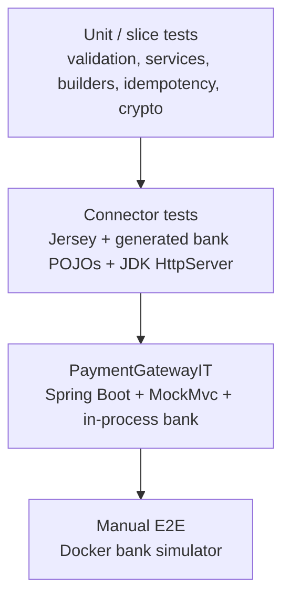

# Payment Gateway — Java Take-Home

A Java 17 / Spring Boot 3.1.5 payment gateway take-home. I focused on making the payment flow
traceable, keeping module responsibilities explicit, and showing how idempotency and card-data
protection fit into a small contract-first service.

---

## At a Glance

- `POST /payments` processes a card payment and returns an authorized or declined result.
- `GET /payment/{id}` retrieves a stored payment.
- OpenAPI defines the public and bank contracts.
- `requestKey` makes retries idempotent.
- CVV is never persisted; PAN is encrypted at rest.
- POST omits the card number; GET returns a masked card number.
- Integration tests run under Failsafe with `mvn verify`.

---

## What I Wanted to Demonstrate

- **Contract-first delivery:** OpenAPI drives the public API models, validation and documentation,
  reducing drift between the contract and implementation.
- **Clear boundaries:** the Maven modules separate the web entry point, payment use cases, connector
  SPI and bank-specific HTTP adapter. Within `gateway-app`, creation, authorization, querying,
  idempotency, persistence and routing have distinct responsibilities.
- **Safe retry behavior:** a request key is reserved before external side effects; completed and
  failed outcomes are replayed, while concurrent duplicates and changed payloads are rejected.
- **Deliberate handling of sensitive data:** the bank receives a transient payment command; only
  encrypted PAN is kept in the payment store, and response builders enforce different POST and GET
  exposure.
- **Testable integration seams:** the connector SPI supports isolated service tests and a
  replaceable bank adapter, with unit, connector and end-to-end coverage.

---

## Key Design Decisions

### 1. Contract first, generated at build time

The public API is defined in
[`payment-gateway.yaml`](gateway-app/src/main/resources/openapi/payment-gateway.yaml). The controller
implements the generated `PaymentsApi`, and request/response models plus Bean Validation are
generated from the same contract.

This keeps documentation, validation and implementation from drifting apart.

### 2. Feature-shaped packages, bounded services

The application lives under one payment feature:

```text
app.payment.api
app.payment.api.builder
app.payment.application
app.payment.domain
app.payment.idempotency
app.payment.persistence
app.payment.routing
```

The original large operation is split by responsibility:

| Service | Responsibility |
| --- | --- |
| `PaymentCreationService` | validation, idempotency reservation, creation orchestration |
| `PaymentAuthorizationService` | bank routing, connector invocation, response creation, persistence |
| `PaymentQueryService` | lookup and GET mapping |

All beans use constructor injection with `final` fields. There is no field injection.

### 3. Thin controller, explicit use-case services

The controller only adapts HTTP to the generated API:

```text
POST -> PaymentCreationService
GET  -> PaymentQueryService
```

It contains no repository access, business branching, or DTO assembly.

### 4. Idempotency before side effects

`requestKey` is reserved atomically before the bank is called. The state machine distinguishes:

- `IN_PROGRESS`
- `COMPLETED`
- `FAILED`

A completed retry replays the stored response. A failed retry replays the terminal failure without
calling the bank again. A duplicate while the first request is running returns `409`.

The idempotency fingerprint is a compact SHA-256 over canonical fields. PAN, CVV and wallet tokens
are hashed individually; the full request is not serialized.

### 5. Explicit card-data boundary

Sensitive card data follows one deliberate path:

```text
PaymentCommand (transient)
        |
        v
PaymentPersistenceMapper
        |
        +-- CardDataProtector.encrypt(paymentId, PAN)
        v
StoredPayment(payment, encryptedPan)
        |
        v
PaymentRepository
```

CVV is not part of `StoredPayment`, the repository API, or the read model. It exists only while
building and sending the bank request.

`CardDataProtector` uses AES-GCM with a random IV and a per-payment key derived from the payment id.
The master key is in-memory for this exercise; production would use KMS/HSM.

The repository read model returns only:

```text
PaymentRecord(payment, maskedCardNumber, cardNumberLastFour)
```

The full PAN does not leave the persistence boundary on GET.

### 6. Different exposure for POST and GET

| Operation | Card data in response |
| --- | --- |
| `POST /payments` | brand, last four, expiry; no `source.number` |
| `GET /payment/{id}` | masked `source.number` plus last four and expiry |

Response mapping is split into:

- `PaymentResponseBuilder` — shared fields;
- `CreatePaymentResponseBuilder` — POST exposure;
- `GetPaymentResponseBuilder` — GET exposure.

This makes the security rule visible in the type structure rather than an `if` buried in a mapper.

### 7. Stable connector SPI

`connector-api` owns `IPaymentProcessor`, `PaymentCommand` and `PaymentOutcome`.
`connector-bank` implements the SPI with a Jersey 2.35 client. The application layer never imports
the concrete bank connector.

### 8. Test gates that actually run

Unit and slice tests run with Surefire. The multi-layer test is `PaymentGatewayIT` and runs under
Failsafe during `mvn verify`, so integration tests are not silently skipped.

---

## Architecture



### Module boundaries

| Module | Responsibility |
| --- | --- |
| `gateway-web` | Boot application, web filters, Swagger/Actuator |
| `gateway-app` | Payment feature: API, application, domain, persistence |
| `connector-api` | Stable SPI and shared error envelope |
| `connector-bank` | Bank simulator adapter |

---

## End-to-End Flows

### Processing a payment



### Retrieving a payment’s details



### Idempotency states



### Card-data protection



---

## API Surface

### Request

```json
{
  "requestKey": "8f14e45f-ceea-467a-9d0b-1c0a7c3a9e21",
  "bankId": "bank-simulator",
  "source": {
    "type": "CREDIT_CARD",
    "brand": "VISA",
    "number": "4543474002249996",
    "expiryMonth": 6,
    "expiryYear": 2030,
    "cvv": "956"
  },
  "amount": { "value": 6540, "currency": "USD" }
}
```

- `source.type`: `CREDIT_CARD` or `WALLET`
- `amount.currency`: `GBP`, `USD`, `EUR`
- `requestKey` is mandatory

### POST response

```json
{
  "id": "8f14e45f-ceea-467a-9d0b-1c0a7c3a9e21",
  "amount": { "value": 6540, "currency": "USD" },
  "bankId": "bank-simulator",
  "status": "Authorized",
  "source": {
    "type": "CREDIT_CARD",
    "brand": "VISA",
    "cardNumberLastFour": "9996",
    "expiryMonth": 6,
    "expiryYear": 2030
  },
  "processedOn": "2026-11-13T08:00:00Z",
  "processing": { "authCode": "auth-123" }
}
```

### GET response

```json
{
  "id": "8f14e45f-ceea-467a-9d0b-1c0a7c3a9e21",
  "amount": { "value": 6540, "currency": "USD" },
  "bankId": "bank-simulator",
  "status": "Authorized",
  "source": {
    "type": "CREDIT_CARD",
    "number": "**** **** **** 9996",
    "cardNumberLastFour": "9996",
    "expiryMonth": 6,
    "expiryYear": 2030
  },
  "processedOn": "2026-11-13T08:00:00Z",
  "processing": { "authCode": "auth-123" }
}
```

Errors use the shared envelope with `id`, `status: Rejected`, `code`, `message` and field errors.

---

## Assumptions and Boundaries

This is a local, single-process take-home implementation, not a production payment service. The
assumptions below define what this implementation promises and where it deliberately stops.

### Assumptions

- `requestKey` identifies one logical payment. A client reuses it only for an equivalent retry;
  reusing it with a different request fingerprint returns a conflict.
- Amounts are positive integer minor units, and the supported currencies are GBP, USD and EUR.
- Authorization is synchronous: the configured simulator returns an authorized or declined
  outcome. There is no pending/unknown payment state.
- The public contract describes both card and wallet sources, but the configured bank connector
  supports card payments only; wallet requests are rejected by the application.
- A process-local store and encryption key are acceptable for demonstrating the flow, but provide
  neither durability nor cross-instance consistency.

### Included boundary

- `POST /payments` validates and processes a payment; `GET /payment/{id}` retrieves it.
- One configured bank simulator is selected through the connector SPI and fail-fast registry.
- The payment store keeps the response payload and encrypted PAN. CVV is transient and never
  persisted.
- POST responses omit the card number; GET responses add only a masked number and last four digits.
- Validation and unexpected failures use a shared API error envelope; `X-Request-Id` supports
  request correlation.

### Deliberately out of scope

- Authentication, authorization, tenant isolation and rate limiting.
- Durable payment or idempotency storage, database transactions and an outbox.
- Bank-side idempotency, reconciliation and recovery of ambiguous timeouts.
- Full PCI certification, KMS/HSM integration and key rotation.
- 3DS, capture, refund, void, webhooks and settlement.
- Multi-instance deployment.

### Known trade-offs

- A restart loses payments and idempotency records; the in-memory encryption key is also process
  scoped.
- The generated API response DTO is reused as the in-memory persistence payload. GET enriches that
  response with a masked number, so POST replay explicitly removes it again.
- A bank timeout can leave the actual authorization outcome unknown; the current model records a
  terminal failure and has no reconciliation path.
- There is no authentication or tenant ownership, so this service must not be exposed as-is.

---

## Testing Strategy



### Current result

- **82 tests**
  - `gateway-app`: 39 unit tests
  - `connector-bank`: 15 tests
  - `PaymentGatewayIT`: 28 integration tests

```bash
./mvnw clean verify
```

`mvn test` runs unit/slice tests; Failsafe runs `PaymentGatewayIT` during `verify`.

---

## Running Locally

### Prerequisites

- JDK 17
- Docker for the bank simulator

### Start

```bash
docker compose up -d
./mvnw clean verify
./mvnw -pl gateway-web -am spring-boot:run
```

Gateway: `http://localhost:8090`
Swagger UI: `http://localhost:8090/swagger-ui/index.html`

### Example

```bash
curl -i -X POST http://localhost:8090/payments \
  -H 'Content-Type: application/json' \
  -d '{
    "requestKey": "8f14e45f-ceea-467a-9d0b-1c0a7c3a9e21",
    "bankId": "bank-simulator",
    "source": {
      "type": "CREDIT_CARD",
      "brand": "VISA",
      "number": "2222405343248877",
      "expiryMonth": 6,
      "expiryYear": 2030,
      "cvv": "956"
    },
    "amount": { "value": 100, "currency": "GBP" }
  }'
```

### Configuration

| Property | Default | Purpose |
| --- | --- | --- |
| `server.port` | `8090` | Gateway port |
| `connector.bank.simulator.base-url` | `http://localhost:8080` | Bank simulator URL |
| `connector.bank.simulator.connect-timeout` | `2s` | Jersey connect timeout |
| `connector.bank.simulator.read-timeout` | `3s` | Jersey read timeout |

---

## Future Evolution

1. Replace in-memory storage with PostgreSQL and a durable idempotency table.
2. Separate API DTOs from domain and persistence models.
3. Use KMS/HSM for encryption keys and rotation.
4. Add authentication, merchant scopes, tenant ownership and rate limiting.
5. Add circuit breakers, bulkheads and bank-specific idempotency.
6. Model `PENDING`/`UNKNOWN` outcomes and reconciliation.
7. Add Testcontainers, contract tests and concurrency tests.
8. Add metrics, tracing and PII-safe audit logs.

---

## Project Layout

```text
gateway-web/          Boot application, filters, Swagger/Actuator
gateway-app/          payment feature
  payment/api         controller + response builders
  payment/application creation, authorization, query services
  payment/domain      validation
  payment/idempotency state machine + fingerprint
  payment/persistence encrypted store + mapper
  payment/routing     connector registry
connector-api/        IPaymentProcessor SPI + errors
connector-bank/       bank simulator adapter + Jersey client
```
